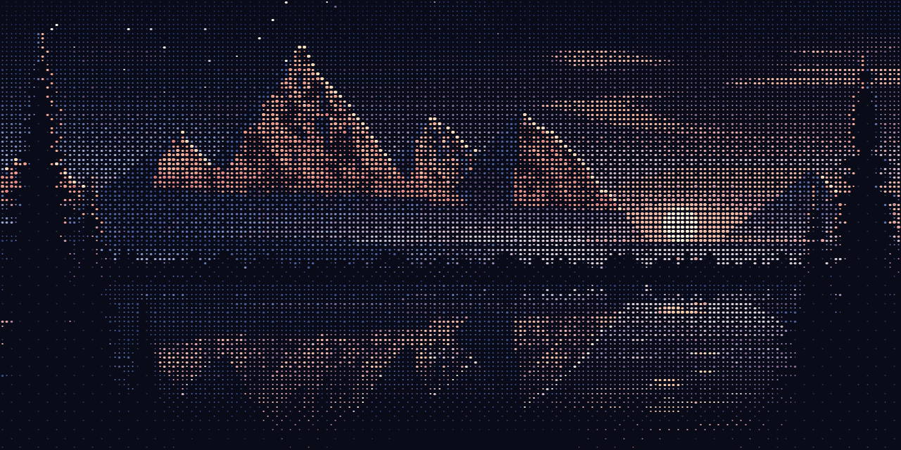

  <picture>
    <source media="(prefers-color-scheme: dark)" srcset="assets/profile-dark.svg" />
    <source media="(prefers-color-scheme: light)" srcset="assets/profile-light.svg" />
    
  </picture>

  <a href="https://ascii.rest/alpine-dawn/">
    <picture>
      <source media="(prefers-reduced-motion: reduce)" srcset="assets/alpine-dawn-still.png" />
      
    </picture>
  </a>
   
  Alpine dawn by <a href="https://ascii.rest/">ascii.rest</a>

I'm a self-taught student developer passionate about creating efficient and innovative solutions. I love exploring new technologies and building projects that make a difference.

- **Status**: Mechanical Student
- **Learning Style**: Self-taught

## Tech Stack

  

## GitHub Activity

---

## Profile Views

  
  

